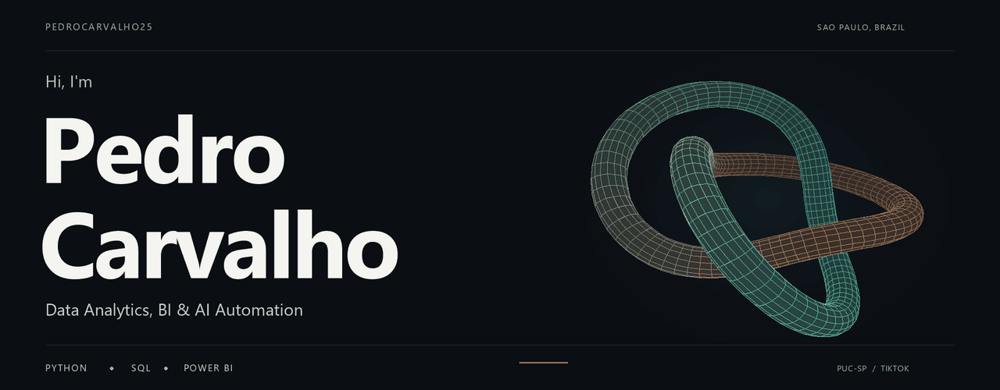
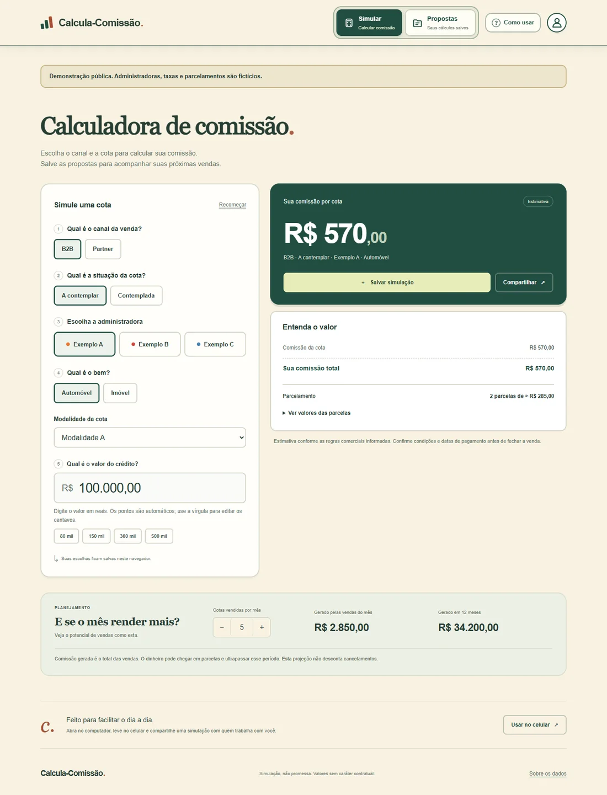
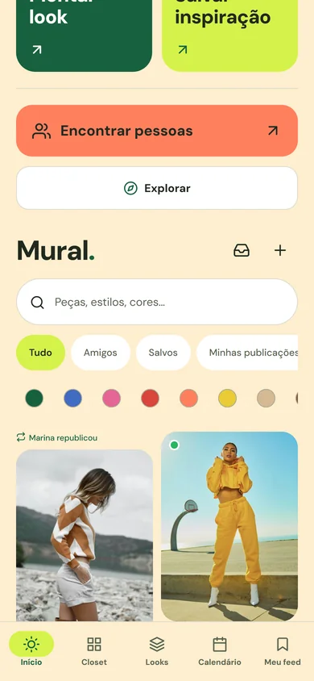

  <picture>
    <source media="(prefers-reduced-motion: reduce)" srcset="assets/profile-cover.svg" />
    
  </picture>

  <a href="#a-bit-about-me">About me</a> &nbsp; / &nbsp;
  <a href="#what-im-building">Projects</a> &nbsp; / &nbsp;
  <a href="https://www.linkedin.com/in/pedro-carvalho-da-silva-/">Say hello</a>

## A bit about me

I'm Pedro, based in São Paulo. I'm studying **Data Science and AI at PUC-SP** and currently interning at **TikTok**. Before that, I worked at Porto Seguro and MetLife.

I'm interested in **data analytics, Business Intelligence and AI automation**. I like talking through a problem before deciding what to build. Sometimes it calls for an analysis; sometimes the useful thing is an app that makes someone's work easier. That's where the projects below came from.

My data toolkit includes **Python, SQL (MySQL and PostgreSQL), Power BI, Google Cloud and Microsoft Azure**. My public projects also use Java, JavaScript, TypeScript, React, Node.js and relational databases.

Have a look around. If you're hiring or want to talk about a project, [say hello on LinkedIn](https://www.linkedin.com/in/pedro-carvalho-da-silva-/).

## What I'm building

### Calcula-Comissão

A client was already using an HTML prototype to calculate commissions. I helped turn it into a web app for running simulations, organizing proposals and working across phone and desktop.

It handles calculations in cents, keeps a history, exports records and can be installed as a PWA. This public edition uses fictional commercial data.

[The story behind the project](https://github.com/PedroCarvalho25/calcula-comissao/blob/HEAD/docs/PORTFOLIO.md) · [Repository](https://github.com/PedroCarvalho25/calcula-comissao)

  
Take a look at the app

   
  

### Virtual Closet

You know that piece of clothing you forget you own? I'm building a digital wardrobe to organize clothes, save inspiration and try combinations with what you already have.

This is my own project, and it's **still in development**. It's built with Expo, React Native, TypeScript and Supabase. It tracks wear history, calculates cost per wear and suggests combinations using category and color rules. Realistic virtual try-on is still experimental.

<table>
  <tr>
    <td width="33%"></td>
    <td width="33%"></td>
    <td width="33%"></td>
  </tr>
</table>

[Explore Virtual Closet](https://github.com/PedroCarvalho25/virtual-closet)

### Keener: inventory management

A technical case with product records, stock entries and withdrawals, and a movement history. I built it with React, Node.js, SQLite and Prisma.

Every stock change needs a recorded movement. The app also prevents withdrawals that would take inventory below zero.

[See the project](https://github.com/PedroCarvalho25/keener-estoque)

  
Here for a data role?

   

  My focus is **Data Analytics, Business Intelligence and AI automation**. The public repositories here are applications; I haven't published a dedicated Python analysis or Power BI case yet.

  Calcula-Comissão documents how I worked through a client's requests and delivered the app. Virtual Closet covers structured records, usage history and privacy. Keener deals with transactions and keeping inventory consistent.

## Let's talk

[LinkedIn](https://www.linkedin.com/in/pedro-carvalho-da-silva-/) · [All repositories](https://github.com/PedroCarvalho25?tab=repositories)
