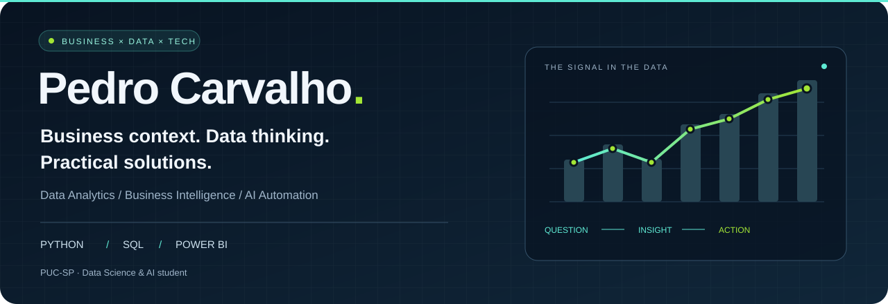

  

  <a href="#the-person-behind-the-data">ABOUT</a> ·
  <a href="#my-focus">FOCUS</a> ·
  <a href="#selected-work">SELECTED WORK</a> ·
  <a href="https://www.linkedin.com/in/pedro-carvalho-da-silva-/">LET'S CONNECT ↗</a>

## The person behind the data

I'm **Pedro Carvalho**, a **Data Science & AI student at PUC-SP** and **intern at TikTok**, with previous experience at **Porto Seguro** and **MetLife**.

My direction is **Data Analytics, Business Intelligence and AI automation**. I'm interested in connecting the business question to the data, the decision and the tools people actually use. My public projects currently show the product and software side of that journey: building interfaces, working with databases and translating practical needs into usable applications.

> **Context first. Clear reasoning. Useful outcomes.**

  <a href="https://www.linkedin.com/in/pedro-carvalho-da-silva-/">LinkedIn ↗</a> &nbsp;·&nbsp;
  <a href="https://github.com/PedroCarvalho25?tab=repositories">Explore my repositories ↗</a> &nbsp;·&nbsp;
  São Paulo, Brazil

## My focus

| Direction | What I want to bring to the work |
| :--- | :--- |
| **Data Analytics · Python · SQL** | Well-framed questions, structured data and analysis people can understand. |
| **Business Intelligence · Power BI** | Clear metrics, readable dashboards and context for business decisions. |
| **AI & automation** | Practical workflows that connect information, tools and human review. |
| **Product & engineering** | Interfaces and applications that turn a business need into a usable solution. |

**Tools in my data focus:** Python · SQL · Power BI  
**Technologies represented in my public work:** JavaScript · TypeScript · React · React Native · Node.js · PostgreSQL · Supabase · SQLite · Prisma

## Selected work

Three projects. Three ways of turning a practical problem into software.

### 01 / Calcula-Comissão

**A business need, turned into a working tool.**

I evolved a client's existing prototype into a responsive application for commission simulations and proposal organization. The public edition uses fictional commercial data.

- **Business lens:** understand the workflow, preserve calculation rules and make everyday information easier to use.
- **Technical evidence:** JavaScript, PWA, calculations in cents, account flows, persistence and documented delivery decisions.

**[Read the case study ↗](https://github.com/PedroCarvalho25/calcula-comissao/blob/HEAD/docs/PORTFOLIO.md)** · [Explore the code ↗](https://github.com/PedroCarvalho25/calcula-comissao)

---

### 02 / Virtual Closet

**Personal information, organized into a visual product.**

An authorial digital wardrobe project connecting owned items, inspiration, outfit planning and more intentional purchase decisions. **In development.**

- **Data lens:** structured records, usage history, cost per wear and explainable, deterministic suggestions.
- **Technical evidence:** Expo, React Native, TypeScript, Supabase/PostgreSQL, private storage, Row Level Security and documented tests.

<table>
  <tr>
    <td width="33%"></td>
    <td width="33%"></td>
    <td width="33%"></td>
  </tr>
</table>

**[Explore the product and its current limits ↗](https://github.com/PedroCarvalho25/virtual-closet)**

---

### 03 / Keener — Inventory Control

**Reliable records behind everyday operations.**

A full-stack inventory application built as a technical case, with authentication, product management and a history of stock movements.

- **Data lens:** traceable changes, consistent inventory and rules that prevent stock from becoming negative.
- **Technical evidence:** React, Node.js, Express, SQLite, Prisma, Zod and API tests.

**[Explore the architecture and code ↗](https://github.com/PedroCarvalho25/keener-estoque)**

  
<strong>Looking at my profile for a data role? Start here ↓</strong>

   

  My target direction is **Data Analytics, BI and AI automation**. The repositories above provide evidence of adjacent skills: understanding business needs, modeling and persisting information, validating rules and delivering usable tools.

  For business context and delivery decisions, start with the **Calcula-Comissão case study**. For structured data, privacy and explainable product logic, explore **Virtual Closet**. For transactions and data consistency, explore **Keener**.

  The public portfolio currently emphasizes applications. Dedicated Python analysis and Power BI cases are not yet represented in these repositories.

## Let's connect

Interested in opportunities at the intersection of **business, data and technology**, with a focus on **Data Analytics, Business Intelligence and AI automation**.

**[Find me on LinkedIn ↗](https://www.linkedin.com/in/pedro-carvalho-da-silva-/)**

  

